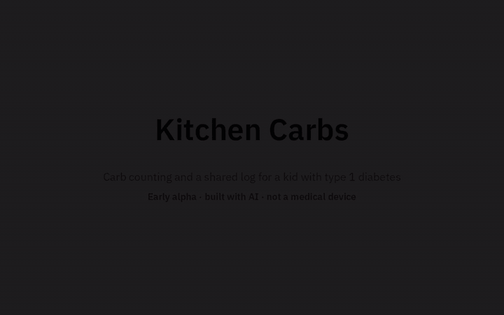
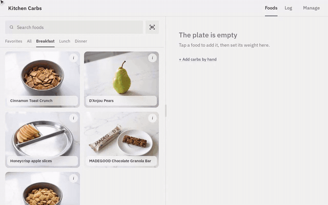
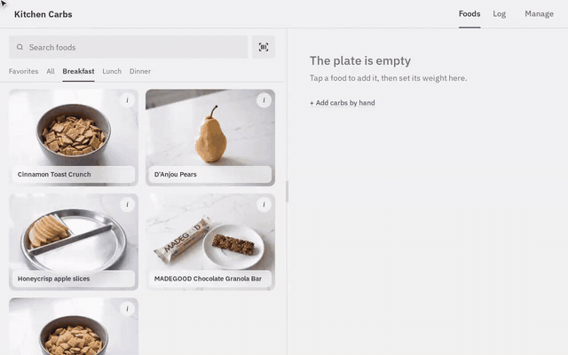
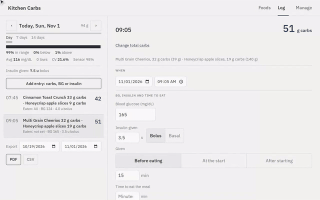
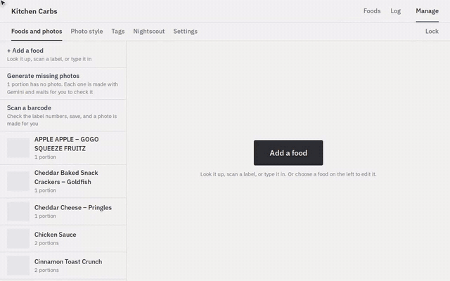
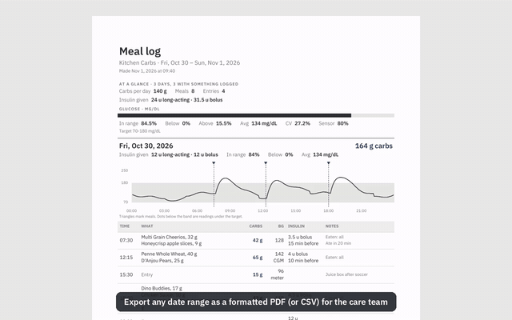
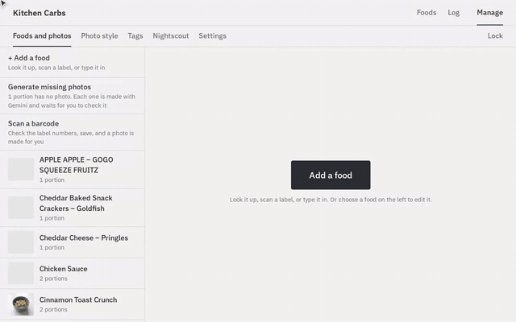
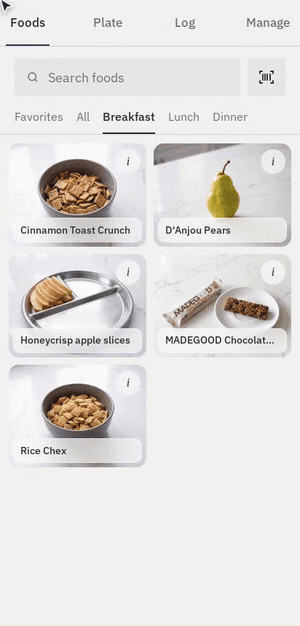

# Kitchen Carbs

> [!CAUTION]
> ## ⚠️ Early alpha · built with AI · use at your own risk
> **Kitchen Carbs was developed with AI (Claude) by a parent, for one family. Treat it as an early alpha that
> carries a lot of risk.** It has not been clinically validated, independently reviewed or tested at scale, and
> it is **not a medical device**.
>
> - Carb counts, food data, photos and calculations can be wrong. AI wrote much of the code and AI reads labels
>   and makes the photos; any of it can contain mistakes.
> - The meal summary works out an insulin dose from settings a parent types in. **Never give insulin based on
>   this app alone.** Check every number against the package label, your pump or meter, and your care team's
>   plan.
> - Security has been reviewed, but this is hobby software holding health data. Run it only on hardware you
>   control, behind sign-in, and keep backups.
> - It comes with no warranty of any kind (GPL v3, sections 15 and 16).
>
> If you are not comfortable checking its work every time, don't use it.



*[Sizzle reel as MP4](docs/media/sizzle.mp4). All demos use made-up data: no real meals, readings or doses.*

A kitchen-tablet and phone app for a family managing a child's type 1 diabetes: look up carbs by portion, add up
a plate by weight, log meals with BG and insulin, see the CGM curve after each meal from Nightscout, export a
report for the care team, and optionally sync to Tidepool. The design and rules come from the OKF concept map in
`okf/` (see `PLAN.md`).

## Demo reels

### Build a plate
Foods are photo cards sorted by tags. Search, tap to add, pick a portion, then set the real weight with the
slider or a Bluetooth kitchen scale; the plate adds up the carbs.

 · [MP4](docs/media/plate.mp4)

### Meal summary
Save to log opens a summary: date and time, BG from the CGM (or a meter reading), a dose worked out from the
parent's own ratios (shown only here, never stored or sent), and what was actually given.

 · [MP4](docs/media/summary.mp4)

### The log
Each day with time in range, the glucose curve after each meal, edits with a floating Save bar, comments, and
manual entries for juice, meter readings or long-acting insulin.

 · [MP4](docs/media/log.mp4)

### Foods and photos
Behind a parent PIN: each food's source and checked carbs, its portions, and photos styled by Gemini to match the
family's own plates, each checked by a parent before use.

 · [MP4](docs/media/manage.mp4)

### Reports
A formatted PDF (or CSV) of any date range: daily glucose traces with meals marked, time in range, and every meal
and dose as logged.

 · [MP4](docs/media/export.mp4)

### Settings and sync
Insulin ratios by time of day, the log's rules, push notifications to parents' phones, and Tidepool sync.

 · [MP4](docs/media/settings.mp4)

### On a phone
The same app on a phone: add foods, open the plate, check the log.

 · [MP4](docs/media/phone.mp4)

## Environments

| | data | port | start |
|---|---|---|---|
| dev | `data-dev/` (sample data) | 8090 | `tools/dev.sh` |
| QA | `data-qa/`, a fresh copy of production | 8093 on the homelab | `tools/qa.sh` |
| production | `data/` | 8092 on the homelab, HTTPS via Cloudflare | `tools/deploy.sh` |

All three read `GEMINI_KEY`, `FAT_SECRET_CLIENT_ID` and `FAT_SECRET_CLIENT_SECRET` (FatSecret OAuth 2.0; add the server's public IP to the key's allowlist in the FatSecret developer portal) from `.env`, written as `NAME=value`, (in this folder or the parent folder). Keep `.env` out of git and
off the image; Docker passes it in when the container starts. Ports change with `DEV_PORT`, `QA_PORT`, `PROD_PORT`. Dev and production both default to 8090, so on the same machine stop the dev server or set `DEV_PORT`.

### HTTPS
The app serves plain http. In production a Cloudflare Tunnel provides HTTPS in front of port 8092. Browsers only
allow the camera (live barcode scanner) and Bluetooth (kitchen scale) on a secure address: the Cloudflare https name,
or http://localhost in dev. Opened by LAN IP over plain http, those two fall back to photo or typed entry.

### First install on the server
1. Install Docker with the compose plugin, copy this folder over, and put `GEMINI_KEY=...` in `.env`.
2. `tools/deploy.sh --yes` (there is nothing in QA to check yet).
3. On the tablet, open `http://<server IP>:8090` and add it to the home screen.
4. **Manage**: create a parent PIN, connect Nightscout with a `readable` token (not the API secret),
   then scan labels or check the sample foods.

### Releasing a change
1. `tools/qa.sh` copies production's data into `data-qa/` and starts the new code on it (port 8091).
   New migrations run on the copy; production is only read. The QA screen shows a banner.
2. Check QA on the tablet.
3. `tools/deploy.sh` runs the tests in Docker, asks whether QA was checked, copies production to
   `data/backups/pre-deploy-<time>/`, then restarts production. Pending migrations make their own backup too.
4. `tools/qa.sh stop` when done.

### Database migrations
Schema changes live in `app/server/migrations.py` as a numbered list; the database records the last one
applied. To change tables for a feature, **append** a migration; never edit or reorder shipped ones.
Each runs in a transaction after a backup to `data/backups/pre-migration-...db`; if one fails it rolls back
and the app won't start, leaving the data as it was. A database newer than the code is refused.

### Restoring a backup
`docker compose stop kitchen-carbs`, copy the backup over `data/app.db`, deploy the code that matches it.

## Develop
```
tools/dev.sh                                    # http://localhost:8090, reloads on change
cd app && ../.venv/bin/python -m pytest tests   # all tests
```

## Notes
- Meals are grouped by the home computer's local day; past days are read-only.
- The tablet keeps foods, the plate and unsent meals in its browser, so the app keeps working if the
  server goes down while it is open. Reloading needs the server.
- Sample foods and photos are placeholders: values are "Not verified" and photos are "Estimated".

## Production on the homelab
Production runs on a home server in `~/t1d/kitchen-carbs`; the keys are in `~/t1d/.env` and the ports in
`~/t1d/kitchen-carbs/.env` (`PROD_PORT=8092`, `QA_PORT=8093`). `KC_OFF_CONTACT` in `~/t1d/.env` is the contact
address sent to Open Food Facts, and `KC_FRAME_ANCESTORS` (space-separated origins, e.g. a Home Assistant
dashboard) the sites allowed to show the app in a frame. To ship a new version from the laptop (`SERVER` is your `user@host`):

    rsync -a --exclude .git --exclude .venv --exclude data-dev --exclude data --exclude data-qa \
      --exclude __pycache__ --exclude .pytest_cache --exclude .env ./ $SERVER:t1d/kitchen-carbs/
    ssh $SERVER 't1d/kitchen-carbs/tools/qa.sh'       # check http://<host>:8093
    ssh $SERVER 't1d/kitchen-carbs/tools/deploy.sh'
    tools/release.sh --deployed                        # after a good deploy: version, tag, GitHub release

Write what changed under `## Unreleased` in [CHANGELOG.md](CHANGELOG.md) as you go; `tools/release.sh` turns it
into the dated version, tags it, and publishes a GitHub release with those notes (it needs `gh auth login` and an
`origin` remote; until then the tags stay local and are published on the next run).

The schema is frozen at version 1 since the first deploy: new tables or columns are new migrations.

## Google sign-in (Firebase)
Off until a Firebase project is set (okf/architecture/auth.md). To turn it on:
1. Firebase console → your project → Authentication → Sign-in method → enable **Google**.
2. Authentication → Settings → **Authorized domains**: add the Cloudflare Tunnel name the tablet opens
   (e.g. `kitchen.example.com`), and `localhost` for dev.
3. Project settings → Your apps → Web app → copy the config into `~/t1d/.env` on the server:

       FIREBASE_API_KEY=...
       FIREBASE_AUTH_DOMAIN=<project>.firebaseapp.com
       FIREBASE_PROJECT_ID=<project>
       KC_ALLOWED_EMAILS=parent@gmail.com,other.parent@gmail.com

4. Deploy. Every device then signs in once with Google and stays signed in for 30 days (renewed while used).
   The allow list can be edited later in Manage → Settings → Family accounts; the PIN still guards Manage.

## License
Kitchen Carbs is free software under the GNU General Public License, version 3 (see [LICENSE](LICENSE)).
Bundled third-party files keep their own licenses: Kitchen Sans, a subset of IBM Plex Sans renamed as its
license requires, under the SIL Open Font License 1.1
(`app/web/fonts/OFL.txt`, `app/server/fonts/OFL.txt`), and the barcode reader under MIT and Apache-2.0
(`app/web/vendor/licenses/`).

It is a carb-counting and logging aid, not a medical device, and comes with no warranty (sections 15–16 of the
license). Doses it shows are arithmetic on the settings a parent enters; check them against the care team's plan.
